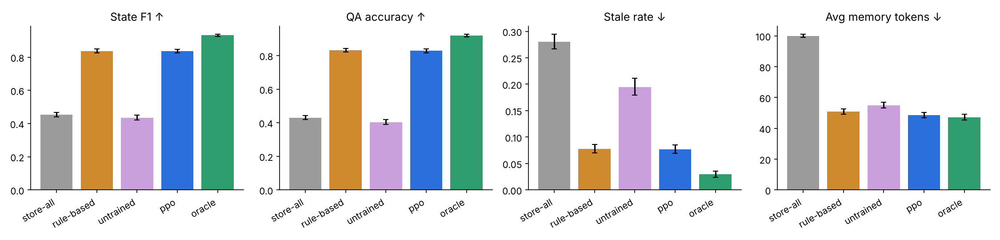

# MNEMO — RL-trained memory management for LLM agents

> An agent that learns **what to remember, update, ignore and forget** over a conversation, kept in a temporal **MongoDB**
> store under a hard token budget, with a live dashboard, streaming explanations and a rigorous evaluation harness.



## Headline results (300 held-out episodes, mean, paired 95% CIs in `results/RESULTS.md`)

| System | State F1 ↑ | QA acc ↑ | Stale ↓ | Junk ↓ | Avg tokens ↓ | Harmful deletions ↓ |
|---|---|---|---|---|---|---|
| store-all (FIFO at budget) | 0.454 | 0.430 | 28.0% | 27.2% | 100.0 | 3.14 |
| rule-based (thresholds tuned on val) | 0.837 | 0.832 | 7.8% | 7.4% | 50.8 | 0.63 |
| **MNEMO-PPO (3 seeds)** | **0.836** | **0.828** | **7.7%** | **5.6%** | **48.6** | **0.48** |
| oracle (reads ground truth; ceiling) | 0.931 | 0.919 | 3.0% | 0.7% | 47.2 | 0.12 |

**Honest reading:** the learned policy halves memory tokens and removes most stale/junk records versus naive storage
(+0.38 F1, +0.40 QA, p<0.001). Against a *validation-tuned* hand-written rule baseline it is **statistically tied on F1 and QA**
and modestly better on junk, tokens and harmful deletions. Details, OOD split, noise/budget sweeps, ablations and limitations:
[`results/RESULTS.md`](results/RESULTS.md), [`docs/METHODOLOGY.md`](docs/METHODOLOGY.md).

## What is in the box

* **Temporal memory store** — `ADD/UPDATE/IGNORE/DELETE` with validity windows, expiry, bounded history and a hard budget
  (`src/mnemo/operations.py`), on **MongoDB** (`store/mongo.py`) or an in-memory twin (parity-tested).
* **Procedural benchmark with exact ground truth** and a calibrated extractor-noise model (`src/mnemo/benchmark/`).
* **Gymnasium env + MaskablePPO** training with validation checkpointing (`src/mnemo/rl/`).
* **Evaluation harness** — paired bootstrap CIs, OOD split, noise and budget sweeps, ablations, auto-generated report.
* **Groq agents** — extractor, streaming explainer, QA agent; every one falls back offline.
* **FastAPI + SSE service** and a **React/TypeScript dashboard** (live side-by-side memory, streamed narration, probe questions, results tab).
* 48 tests, ruff-clean, CI, Docker/Compose.

## Quick start

```bash
pip install -e ".[all]"            # Python 3.10+
cd frontend && npm install && npm run build && cd ..
cp .env.example .env               # optional: MONGODB_URI, GROQ_API_KEY
python -m mnemo.cli serve          # http://127.0.0.1:8000  (trained model included; serving is torch-free)
```

With no keys it runs fully offline (in-memory store, heuristic extractor). Set `MONGODB_URI` for MongoDB
(Atlas free tier works) and `GROQ_API_KEY` for the LLM agents. `docker compose up --build` starts Mongo + app.

## Reproduce everything

```bash
make train       # 3 PPO seeds + 3 ablations (~30 min, 2 CPU cores)
make evaluate    # -> results/RESULTS.md, results.json, figures
make test lint
```

All benchmark, reward, noise, PPO and evaluation parameters live in `configs/default.yaml`; attributes, values and phrasing in
`configs/catalog.yaml`; the offline cue lexicon in `configs/cues.yaml`. Nothing is hard-coded in Python.

## Layout

```
configs/    catalog.yaml  default.yaml  cues.yaml
src/mnemo/  operations.py  store/  benchmark/  engine.py  metrics.py  qa.py  rl/  evaluation.py  agents/  service/
frontend/   React + TS dashboard          tests/  48 tests          docs/  METHODOLOGY  ARCHITECTURE  ABSTRACT
models/     trained PPO checkpoints       results/  generated report, figures, results.json
```

## Known limitations

Synthetic benchmark (relative, not absolute, conclusions); PPO over structured claims rather than LLM fine-tuning; the offline
extractor is validated only on benchmark phrasing; the Groq agents and the live-MongoDB test (`pytest -m mongo`, run in CI) were
not exercised against real servers in the authoring sandbox (they are covered with a mock transport and `mongomock`);
no prompted-LLM baseline in the reported numbers. See `docs/METHODOLOGY.md §8`.

Related work: [Memory-R1](https://arxiv.org/abs/2508.19828), [STALE](https://arxiv.org/abs/2605.06527),
[How Memory Management Impacts LLM Agents](https://arxiv.org/abs/2505.16067).
